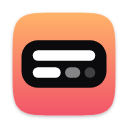

<h1 align="center">
  <br>
  LiveCaptions
</h1>

<h2 align="center">Live English captions for anything your Mac plays.</h2>

<p align="center">
  Follow calls, videos, and podcasts with captions at the notch.
  Speech recognition runs on your Mac, and audio and transcripts stay in memory.
</p>

<p align="center">
  <strong><a href="https://github.com/zerone0x/mac-live-captions/releases/latest">Download for Mac</a></strong>
  · <a href="#install">Install guide</a>
  · <a href="CHANGELOG.md">Changelog</a>
  <br>
  <sub>Apple Silicon · macOS 26 or later · English (US)</sub>
</p>

<p align="center">
  
</p>

## Features

- **Caption system audio.** Follow English speech from meeting apps, browser tabs, and media players.
- **Keep captions in view.** The overlay sits at the notch, appears below the menu bar on displays without a notch, or moves to the bottom of the screen. It lets clicks pass through and offers four text sizes. Settings can also hide the overlay from screen sharing where supported.
- **Start from any app.** Press **⌃⌥C** (Control–Option–C) or use the menu bar. The menu shows whether LiveCaptions is listening, waiting for audio, or needs setup.
- **Keep speech on your Mac.** Apple’s SpeechAnalyzer processes audio locally. LiveCaptions saves only preferences. The one-time English speech model download comes from Apple.

LiveCaptions captions English system audio. Microphone captions, translation, and transcript export are outside the [current scope](docs/SCOPE.md).

## Install

Requires an **Apple Silicon Mac with macOS 26 or later**.

### Terminal

```sh
curl -fsSL https://raw.githubusercontent.com/zerone0x/mac-live-captions/main/scripts/install.sh | bash
```

The [installer](scripts/install.sh) downloads the latest release ZIP, verifies its SHA-256 checksum, installs LiveCaptions in `/Applications`, clears the quarantine flag, and opens the app. It runs without `sudo`. Run the same command to update, or use `bash -s -- 0.1.2` in place of `bash` to select a version.

### DMG or ZIP

1. From the [latest release](https://github.com/zerone0x/mac-live-captions/releases/latest), download the Apple Silicon DMG or ZIP and its matching `.sha256` file. Keep both files in the same folder.
2. In Terminal, change to that folder and run `shasum -a 256 -c` with the downloaded `.sha256` filename. Continue once it reports `OK`.
3. Open the DMG and drag LiveCaptions to Applications. For the ZIP, unzip it and move `LiveCaptions.app` to Applications. Quit any running copy before replacing it.
4. The current download uses an ad-hoc signature. macOS requires the quarantine flag to be cleared for this build. After verifying and moving the app, clear the quarantine flag on that copy and open it.

   ```sh
   xattr -dr com.apple.quarantine /Applications/LiveCaptions.app
   open /Applications/LiveCaptions.app
   ```

macOS may request permissions again after an update. To uninstall, quit LiveCaptions and delete `/Applications/LiveCaptions.app`. To remove its preferences as well, run `defaults delete dev.trine.LiveCaptions`.

## First run

1. Open **Welcome and Setup…** from the LiveCaptions icon in the menu bar.
2. Click **Download English Speech Model** and wait for macOS to finish downloading it.
3. Click **Ask for Permission**, allow LiveCaptions in **System Settings → Privacy & Security → Screen & System Audio Recording**, then click **Relaunch**.
4. Play something with English speech. Choose **Start Captions** in the menu bar or press **⌃⌥C**.

To preview the overlay without playing audio, choose **Debug: Demo Captions** from the menu.

## Report a problem

[Open an issue](https://github.com/zerone0x/mac-live-captions/issues/new) with:

- the app version (`defaults read /Applications/LiveCaptions.app/Contents/Info.plist CFBundleShortVersionString`),
  your Mac model and macOS version (Apple menu → About This Mac);
- the menu's status line and detail text (or a screenshot of the menu);
- what you did, what you expected and what happened instead (for example:
  which app was playing audio, built-in display or external, notch or not).

Known limitations are in [CHANGELOG.md](CHANGELOG.md); hardware checks still
open are on [#29](https://github.com/zerone0x/mac-live-captions/issues/29).
LiveCaptions saves no transcripts or audio, so there is nothing to attach
beyond what you describe; leave out anything private you saw in captions.

## Try a CI build

Every PR and every push to `main` builds the app on GitHub Actions.

1. Open the [CI workflow](https://github.com/zerone0x/mac-live-captions/actions/workflows/ci.yml), pick a green run,
   and download the `LiveCaptions-<sha>` artifact from the run's summary page.
   With the GitHub CLI:
   `gh run download <run-id> --repo zerone0x/mac-live-captions`
2. Unzip it. GitHub wraps the artifact in a zip, so you get
   `LiveCaptions.zip`; unzip that too to get `LiveCaptions.app`.
3. The build is ad-hoc signed, not notarized, so Gatekeeper blocks it as
   downloaded. Clear the quarantine flag, then open it:

   ```sh
   xattr -dr com.apple.quarantine LiveCaptions.app
   open LiveCaptions.app
   ```

4. The app has no Dock icon. Look for the captions icon in the menu bar.
5. To see the caption overlay without audio, choose **Debug: Demo Captions** in
   the menu. It plays a short scripted English feed at the notch (or in a pill
   under the menu bar on displays without a notch).

   To start the demo on launch (it repeats until stopped), pass
   `--demo-captions`:
   `LiveCaptions.app/Contents/MacOS/LiveCaptions --demo-captions`.

Each CI run also uploads `overlay-screenshots-<sha>`: PNG renders of the
overlay in notch and pill style for fixed states (one finalized line,
finalized text plus a volatile tail, a two-line wrap, two finalized lines),
plus the two-line wrap at the extra large text size (`overlay-*-xl-*.png`)
and in the bottom position (`overlay-bottom-*.png`), the menu status states
(`menu-*.png`), Settings and the welcome window. `live-screenshots-<sha>`
has screenshots of the running app with the demo captions. What each file
shows and how to read them: [docs/TESTING.md](docs/TESTING.md#screenshots-from-ci).

Each build has a new ad-hoc signature, so macOS may ask for audio permissions
again after you install a newer build.

Artifacts are kept for 14 days. To list the runs for a branch and download
only the screenshots of one run:

```sh
gh run list --repo zerone0x/mac-live-captions --workflow ci.yml --branch <branch>
gh run download <run-id> --repo zerone0x/mac-live-captions --pattern '*-screenshots-*'
```

The manual test checklist for a real Mac is [docs/TESTING.md](docs/TESTING.md).

## Build locally

Needs Xcode 26 (CI pins 26.6, Swift 6.3) and [XcodeGen](https://github.com/yonaskolb/XcodeGen).

```sh
brew install xcodegen
make            # check-offline, test and build (the default target, `all`)
make package    # build, verify the bundle, zip to build/LiveCaptions.zip
make open       # generate the project and open it in Xcode
```

The built app is at `build/DerivedData/Build/Products/Release/LiveCaptions.app`.
`LiveCaptions.xcodeproj` is generated from `project.yml`; edit `project.yml`, not
the project file. CI runs the same targets (`.github/workflows/ci.yml`).

| Target | What it does |
|---|---|
| `make all` (default) | `check-offline`, `test` and `build`. |
| `make generate` | Generate `LiveCaptions.xcodeproj` from `project.yml` with XcodeGen. |
| `make test` | All package tests (Swift Testing): `test-core`, `test-audio`, `test-speech`. |
| `make test-core` | Core logic tests. Pure Swift, no hardware. |
| `make test-audio` | AudioAdapter tests: PCM conversion with AVFoundation, no capture hardware. |
| `make test-speech` | SpeechAdapter tests. The real-audio test needs `say` and the en-US speech model; it skips with a printed reason when they are missing, and `LIVECAPTIONS_SKIP_REAL_AUDIO=1` skips it on purpose. |
| `make build` | `generate`, then build the ad-hoc signed app into `build/DerivedData`. Warnings are errors (`WARNINGS_AS_ERRORS=NO` turns that off locally); the log goes through `xcbeautify` when it is installed. |
| `make verify` | Check the built bundle with `scripts/verify-app.sh`: menu-bar only, usage strings, arm64, signature with hardened runtime and exactly the expected entitlements, stripped binary. |
| `make package` | `build` and `verify`, then zip the app to `build/LiveCaptions.zip`. |
| `make screenshots` | After a build: render the overlay states to PNG files in `build/screenshots` (the app's `--render-overlay-snapshots` mode). CI uploads them as `overlay-screenshots-<sha>`. |
| `make check-offline` | Fail if networking APIs appear in the sources or remote dependencies in the package manifests (`scripts/check-offline.sh`, `scripts/check-dependencies.sh`). |
| `make check-linked-frameworks` | After a build: fail if the binary links a framework outside the allow-list or imports networking symbols (`scripts/check-linked-frameworks.sh`). |
| `make format` | Reformat the Swift sources with swift-format (part of the Swift toolchain; config in `.swift-format`). |
| `make format-check` | Fail if a Swift source is not formatted (`swift format lint --strict`). CI runs it. |
| `make open` | `generate`, then open the project in Xcode. |
| `make clean` | Remove `build/` and the generated project. |

`CONFIG=Debug make build` builds the Debug configuration instead of Release.
`make verify` and `make package` are meant for Release builds.

The checks themselves have self-tests that CI also runs:
`scripts/check-offline-selftest.sh`, `scripts/verify-app-selftest.sh` and
`scripts/release-selftest.sh`.

## Layout

```
App/              menu-bar app target (thin SwiftUI/AppKit glue)
Packages/Core/    Swift package with the testable logic and pipeline protocols
Packages/SpeechAdapter/  on-device speech recognition (SpeechAnalyzer, en-US)
Packages/AudioAdapter/   PCM conversion for audio capture (AVFoundation)
project.yml       XcodeGen spec
Makefile          build/test commands, shared with CI
scripts/          offline, dependency, linked-framework and bundle checks (CI)
docs/             scope, architecture, decisions, manual testing, research
PRD.md            original long-term vision (Chinese), background only
```

## Project docs

- [Current scope](docs/SCOPE.md)
- [Architecture](docs/ARCHITECTURE.md)
- [Decisions](docs/DECISIONS.md)
- [Testing](docs/TESTING.md)
- [Original product brief (Chinese)](PRD.md)

## Releasing (maintainers)

1. Bump `MARKETING_VERSION` (and `CURRENT_PROJECT_VERSION`) in `project.yml`
   and add a `## [<version>]` section to `CHANGELOG.md` in a PR. CI fails if
   the version has no changelog section (`scripts/release-selftest.sh`).
2. After it merges, tag the merge commit on `main` and push the tag:
   `git tag v0.1.3 && git push origin v0.1.3` (use the version you are releasing)..
3. The [Release workflow](.github/workflows/release.yml) checks that the tag
   equals `MARKETING_VERSION` and is on `main`, runs the tests, builds and
   verifies the Release app, zips it, builds the DMG
   (`scripts/release-dmg.sh`; it mounts the DMG read-only and re-verifies the
   app inside), writes a `.sha256` file for each, installs the zip with
   `scripts/install.sh` into a temporary folder, and creates the GitHub
   Release with the changelog section as its notes and `install.sh`
   attached.

Run it by hand (Actions → Release → Run workflow, or
`gh workflow run release.yml --ref <branch>`) for a dry run: it builds and
packages, uploads the files as a workflow artifact and publishes nothing.
Details: [docs/DECISIONS.md](docs/DECISIONS.md) 0023, 0026 and 0027.
